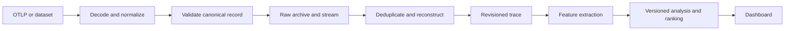
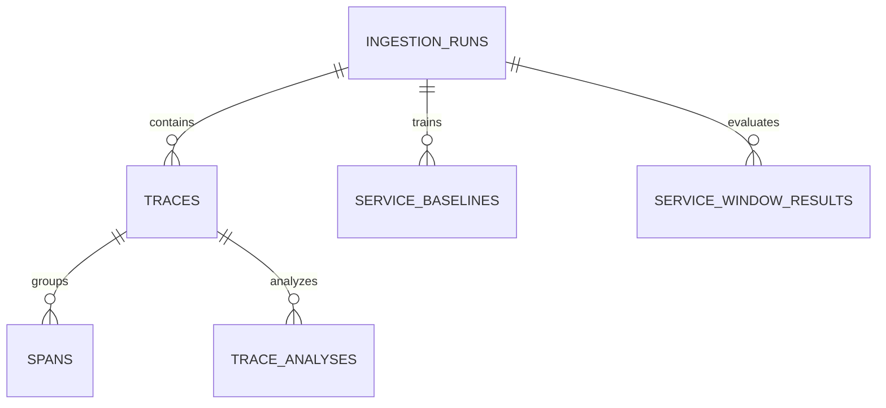

# Trace schema and design decisions

This version defines the shared contract for the team's distributed trace bottleneck analyzer. The collector and dataset adapters produce canonical span records; the stitcher reconstructs traces; the analyzer publishes features and service rankings; the dashboard reads those results. It supports live OpenTelemetry data and replayed datasets while recording differences in what those sources can establish.

The central decision is to keep observations, reconstruction state, and computed conclusions separate. A late observation changes the trace revision and makes its previous analysis stale. Missing timing, status, or topology stays explicit, so an unavailable feature cannot silently become zero.

This is the implemented version 1 contract. The ingestion package now emits this contract for normalized JSONL through `traceingest.canonical`; OTLP HTTP replay continues to emit standard OTLP. The earlier ChatGPT implementation plans included assumed progress, so their status claims are not treated as deployment evidence.

## Files and how to use them

| File | Purpose |
|---|---|
| [canonical-span.schema.json](canonical-span.schema.json) | Machine-readable JSON Schema for an internal span or call observation |
| [schema.sql](schema.sql) | PostgreSQL tables, indexes, views, and ingestion and settlement functions |
| [validate.py](validate.py) | Structural validation plus identity, time, attribute, and cross-field checks |
| [examples/parallel-trace.json](examples/parallel-trace.json) | Checkout with overlapping payment and inventory operations |
| [examples/missing-parent.json](examples/missing-parent.json) | Valid observation whose parent has not arrived |
| [examples/alibaba-call.json](examples/alibaba-call.json) | Call observation with duration but no verified interval |
| [examples/typed-values.json](examples/typed-values.json) | Large integers, bytes, events, links, and an error |
| [check_schema.py](check_schema.py) | Contract and analysis edge-case checks, with optional SQL parsing |
| [check_database.py](check_database.py) | Integration checks against an isolated PostgreSQL database |
| [check_ingestion.py](check_ingestion.py) | Converts the repository fixtures and validates their canonical records |
| [build_contract.py](build_contract.py) | Regenerates the checked-in JSON contract and fixtures |

Install the Python requirements and validate the fixtures from the project folder:

```powershell
python -m pip install -r trace_schema/requirements.txt
python trace_schema/validate.py trace_schema/examples/parallel-trace.json trace_schema/examples/alibaba-call.json
python trace_schema/check_schema.py
python trace_schema/check_ingestion.py
```

Apply `schema.sql` once to a fresh PostgreSQL database using `psql -v ON_ERROR_STOP=1 -f trace_schema/schema.sql`. It creates a separate `trace_v1` schema in one transaction. It is an initial schema definition, not a migration for an existing deployment. PostgreSQL 14 or later is the intended baseline; the verification environment used PostgreSQL 18.

For database checks, first apply the schema to an isolated empty test database, then run `python trace_schema/check_database.py --psql "C:/Program Files/PostgreSQL/18/bin/psql.exe" --port 55439`. The script's data changes are rolled back. Its run IDs are reserved fixture IDs, so use a dedicated test database.

The JSON contract is an internal format. The public OTLP endpoint must decode an actual `ExportTraceServiceRequest`, including its resource and scope groupings, before producing these records. Sending the internal example directly to an OTLP endpoint does not constitute an OTLP request. [OTLP specification](https://opentelemetry.io/docs/specs/otlp/).

### OTLP normalization mapping

For each span in `resourceSpans[].scopeSpans[].spans[]`, use the enclosing resource and scope alongside these mappings. Protobuf follows the same logical fields; decode it with the official message definitions.

| OTLP field | Canonical field or treatment |
|---|---|
| `traceId`, `spanId`, `parentSpanId` | Lowercase hex identifiers; absent/zero parent becomes null with ROOT. Reject an invalid trace or span ID. |
| `name` | `operation_name` |
| `kind` | Map numeric enum 1 through 5 to INTERNAL, SERVER, CLIENT, PRODUCER, CONSUMER; unspecified 0 maps to UNKNOWN. |
| `startTimeUnixNano`, `endTimeUnixNano` | String-valued start/end nanoseconds, UNIX domain; duration is their exact integer difference. |
| `status.code`, `status.message` | Map 0/1/2 to UNSET/OK/ERROR; retain message only for ERROR. An omitted OTLP status defaults to UNSET. |
| `flags`, `traceState` | Preserve span flags and propagation state. An omitted proto flag uses its defined default, rather than an invented sampling probability. |
| `attributes`, `events`, `links` | Convert AnyValue representations recursively and retain order for events and links. |
| Enclosing `resource.attributes` | `resource.attributes`; project service identity from these values. |
| Enclosing `resourceSpans.schemaUrl` | `resource.schema_url` |
| Enclosing `scope` and `scopeSpans.schemaUrl` | `scope` fields and `scope.schema_url` |
| Source `droppedAttributesCount`, `droppedEventsCount`, `droppedLinksCount` | Corresponding span/resource/scope/event/link counters. |
| Collector run, clock, archive pointer, adapter version | `run_id`, `received_at_unix_ns`, and `source`; these are project metadata, not OTLP span fields. |

Decode source defaults according to the source specification before validating this explicit internal representation. An OTLP timestamp equal to zero needs an adapter policy to distinguish a legitimate epoch value from an absent default, using field presence where the decoder exposes it; never label guessed intervals MEASURED. Duplicate source attribute keys need a documented deterministic resolution and a quality flag, or rejection; the internal map has one value per key. Unknown OTLP fields follow the OTLP receiver compatibility rules while the raw archive preserves the original payload.

## Project requirements behind the design

The relevant project conversations were “Create Prototype Roadmap,” “Ecommerce trace datasets,” and “Rank Services for Bottlenecks,” in the ChatGPT Master's Project. They establish the intended architecture and analytical questions, rather than a verified deployed system:

- Accept OTLP JSON and protobuf, plus normalized dataset uploads and replay.
- Stream through Kinesis, preserve raw observations in S3, and reconstruct in Python.
- Handle duplicates, out-of-order spans, missing parents, quiet windows, and late arrivals.
- Store processed data in PostgreSQL and display waterfalls and suspected bottleneck services.
- Support observed self-time, critical-path investigation, latency and error baselines, and slow-trace prevalence.
- Evaluate across Alibaba and application-generated telemetry, including Online Boutique and Astronomy Shop.

The September 30 meeting notes assign trace schema work to Larry. The repository's ingestion package already contained Alibaba, RCAEval, and OTLP adapters plus replay and upload paths. This contract replaces its draft reconstruction boundary while preserving the compact working model used inside those adapters.

## Data flow and ownership



Anu's adapters and replayer produce the canonical contract. Matthew's collector supplies trustworthy ingestion timestamps, raw references, and the selected run ID. Larry's stitcher owns trace state and revision numbers; his analyzer owns quality assessment and computed features. The dashboard receives a presentation derived from these records, including unavailable reasons and stale-result indicators.

Create one ingestion run per independently analyzed live stream or replay execution. Every service participating in one distributed application stream must use the same run. Creating a run per microservice would split the trace. For streaming partitioning, use a stable encoding or hash of `(run_id, trace_id)`; the worker still receives both original fields. Partitioning does not remove the need to handle out-of-order records.

## Canonical span field decisions

Every top-level key is required. Values may be `null` where the source cannot provide them. Empty arrays and objects mean no retained items; dropped counters and quality flags distinguish known loss or unavailable instrumentation. JSON Schema defaults are not relied on to populate fields.

### Identity and topology

| Field | Representation | Why it exists and how it is used |
|---|---|---|
| `schema_version` | `"1.0.0"` | Pins the internal contract independently of the adapter and analysis algorithms. This validator accepts precisely this version. |
| `run_id` | UUID string | Namespaces a live stream or replay. Replaying identical source IDs in another experiment must not overwrite an earlier experiment. |
| `identity_kind` | `OTEL` or `DATASET` | Enables strict OpenTelemetry validation without pretending dataset identifiers are OpenTelemetry IDs. |
| `record_kind` | `SPAN` or `CALL_OBSERVATION` | A call-graph row can be an observation of a call rather than a fully instrumented span. The analyzer must not count two perspectives of one call as two requests. |
| `trace_id` | Nonempty string, maximum 256 characters | Groups a request's operations within a run. OTEL requires 32 lowercase hexadecimal characters and excludes all-zero IDs. DATASET preserves source trace identifiers. |
| `span_id` | Nonempty string, maximum 256 characters | Identifies an observation within its trace. OTEL requires 16 lowercase hexadecimal characters and excludes all-zero IDs. Dataset adapters create reproducible observation IDs. |
| `parent_span_id` | String or `null` | Records the parent without requiring that parent to have arrived. All-zero or absent OTLP parent IDs normalize to `null` with the appropriate relation. |
| `parent_relation` | `ROOT`, `EXPLICIT`, `INFERRED`, `UNKNOWN` | Distinguishes a declared root from an unresolved parent and distinguishes a measured parent link from adapter inference. ROOT and UNKNOWN require a null parent; EXPLICIT and INFERRED require a parent ID. |

OpenTelemetry defines valid trace and span identifiers and parent relationships. The internal ID lengths follow that specification for OTEL records. [OpenTelemetry tracing API](https://opentelemetry.io/docs/specs/otel/trace/api/).

The primary key is `(run_id, trace_id, span_id)`. A trace key is `(run_id, trace_id)`. There is no foreign key from a span to its parent: rejecting a child until its parent arrives would break normal asynchronous delivery. Reconstruction checks missing parents, multiple roots, self-parenting, and cycles. A service may call itself; distinct span IDs make that valid even though a service dependency diagram would show a cycle.

These namespaces support experiments, not access control. A future multi-user deployment must map runs to an authenticated owner or tenant and enforce authorization separately.

### Service and operation identity

| Field | Representation | Decision and reason |
|---|---|---|
| `service_namespace` | String, possibly empty | Separates services with identical names in different application namespaces. Empty means no namespace supplied. |
| `service_name` | Nonempty string | Essential for grouping and ranking. Missing instrumentation uses a documented fallback such as `unknown_service` plus a quality flag; it must not invent a real service name. |
| `service_instance_id` | String or `null` | Supports diagnosing a particular pod or process while ranking the service across instances. |
| `operation_name` | String or `null` | Supports operation-specific baselines. Unknown operation is not replaced with a checkout endpoint guessed from another dataset. |
| `span_kind` | INTERNAL, SERVER, CLIENT, PRODUCER, CONSUMER, UNKNOWN | Distinguishes incoming requests, outgoing calls, messaging, and internal work. It is separate from transport and status. |

The top-level service fields are projections from resource attributes. Validation requires them to agree when `service.name`, `service.namespace`, or `service.instance.id` is present. The complete resource remains available for interpretation. Service name belongs to the resource in OpenTelemetry; operation name belongs to the span. [OpenTelemetry service resource conventions](https://opentelemetry.io/docs/specs/semconv/resource/service/).

Prefer a normalized route such as `POST /checkout` or a stable RPC method as an endpoint key. Do not make a baseline for each URL containing a unique user or order ID. Store application and environment on the run, because those are comparison boundaries for the experiment; an adapter should split heterogeneous applications or environments into different runs.

### Time and precision

| Field | Representation | Decision and reason |
|---|---|---|
| `start_time_ns`, `end_time_ns` | Decimal integer strings or `null` | Preserve exact interval boundaries. Both must be present or both null. |
| `duration_ns` | Decimal integer string or `null` | Carries interval duration or a duration-only dataset measurement. When boundaries exist, it must equal end minus start. |
| `time_domain` | UNIX, RELATIVE, UNKNOWN | Prevents treating an offset in a recording as a wall-clock date. No interval means UNKNOWN. |
| `timing_quality` | MEASURED, DERIVED, DURATION_ONLY, SYNTHETIC, UNKNOWN | Determines which analyses have sufficient evidence. Derived intervals and generated replay schedules are explicitly distinguishable from measured intervals. |
| `received_at_unix_ns` | Decimal integer string | Records collector reception independently of the source event time. The collector controls this field. |

Nanosecond values are strings in JSON and signed `BIGINT` in PostgreSQL. JavaScript numbers cannot represent contemporary epoch nanoseconds exactly. Parse them as `BigInt` or use decimal strings in the frontend; convert small relative offsets to milliseconds only for display. OTLP's JSON representation similarly encodes 64-bit integers as decimal strings. [OTLP JSON encoding](https://opentelemetry.io/docs/specs/otlp/#json-protobuf-encoding).

PostgreSQL's signed BIGINT bounds the accepted nonnegative timestamps and durations to `9223372036854775807`. OTLP uses unsigned fields, so larger values need quarantine or a later wider-storage contract; the normalizer must not truncate them. This choice keeps comparisons and interval arithmetic inexpensive for the prototype. [PostgreSQL numeric types](https://www.postgresql.org/docs/current/datatype-numeric.html).

Keep these invariants:

- End is greater than or equal to start; a zero-duration span is valid.
- MEASURED, DERIVED, and SYNTHETIC require interval boundaries and a known time domain.
- DURATION_ONLY requires a duration and null interval boundaries.
- UNKNOWN timing has null duration and null boundaries.
- A derived end from a verified start and duration is DERIVED rather than MEASURED.
- An epoch value of zero is allowed if it is actually supplied. It is never used to fill missing data.
- Decimal conversion and a declared rounding policy are required when a dataset supplies fractional duration units. Avoid binary floating-point conversion to integer nanoseconds.

Different machines' clocks can disagree. Retain original span intervals. Record children outside parent intervals and relevant clock-skew flags during reconstruction. Do not silently rewrite timestamps until the tree looks plausible. Events may legitimately fall outside a span when custom timestamps were used, so the record validator does not reject them for that alone. [OpenTelemetry events](https://opentelemetry.io/docs/specs/otel/trace/api/#add-events).

Replay speed changes delivery timing, not original operation durations. If a replay rebases measured timestamps to a new epoch, record the original values and transformation in source details and classify the transformed timing as DERIVED. Relative datasets can stay relative. Measure processing freshness using collector reception and processing clocks, rather than subtracting old dataset timestamps from today's date.

### Status and propagation

| Field | Representation | Decision and reason |
|---|---|---|
| `status.code` | UNSET, OK, ERROR, UNKNOWN | UNSET preserves OpenTelemetry's default. UNKNOWN means the dataset provides no status evidence. Neither is automatically success. |
| `status.message` | String or `null` | Optional error explanation, valid only with ERROR. HTTP and RPC numeric status values remain typed attributes. |
| `span_flags` | Unsigned 32-bit integer or `null` | Preserves the exported span flag field without reducing it to one sampled boolean. Missing is unknown. |
| `trace_state` | String or `null` | Preserves vendor propagation state when present. It is not a bottleneck score. |

Do not equate a missing error field with “zero errors.” A status-only error rate uses ERROR in the numerator and OK plus ERROR in the denominator. UNSET spans can be classified by a separately versioned policy using HTTP/RPC attributes or exceptions; that policy must record its denominator and unknown count. Raw status remains unchanged. A downstream-propagated error is evidence of failure, not proof that the reporting service caused it. OpenTelemetry's status semantics inform these distinctions. [OpenTelemetry span status](https://opentelemetry.io/docs/specs/otel/trace/api/#set-status).

### Attributes and optional source context

| Field | Representation | Decision and reason |
|---|---|---|
| `attributes` | Map of typed values | Preserves arbitrary operation attributes without database migrations for each key. |
| `resource.attributes`, `resource.schema_url` | Typed map and optional URL | Retains pod, container, host, version, and environment context along with the source convention version. |
| `scope.name`, `scope.version`, `scope.attributes`, `scope.schema_url` | Instrumentation context | Identifies which library generated the spans and prevents losing context when flattening OTLP resource/scope batches. |
| `events` | Ordered array of name, time, typed attributes, dropped count | Retains exception and custom events. Event times use the record's time domain. |
| `links` | Ordered array of trace/span identifiers, identity kind, flags, state, typed attributes, dropped count | Preserves causal associations such as messaging or batch processing. A link can reference another trace; it is not automatically a parent or blocking dependency. |
| `dropped_counts` | Five nonnegative counters | Retains source-reported loss of span attributes, events, links, resource attributes, and scope attributes. Zero means no reported drops, not proof that every operation was instrumented. |
| `source.format` | String | Identifies the original wire or dataset format and release. |
| `source.adapter_version` | String | Makes normalization reproducible and distinguishes changing adapter behavior from changing data. |
| `source.record_key` | Stable string | Locates an observation within its source; retries must reproduce it. |
| `source.raw_reference` | URI or `null` | Locates the raw archived payload when available. A URI can include an object version and record offset. |
| `source.details` | JSON object | Retains dataset fields, unit assumptions, caller/callee labels, and normalization transformations without adding source-specific core columns. |
| `quality_flags` | Unique strings | Records known source limitations and normalization decisions. Reconstruction adds trace-level findings in analysis quality rather than rewriting accepted spans. |

Typed values have the shape `{"type":"string","value":"/checkout"}`. Supported types are string, bool, int, double, bytes, array, map, and empty. Integer values are signed 64-bit decimal strings; byte values use canonical base64; double values must be finite. Arrays and maps recursively contain typed values. This avoids changing the number `42` into the string `"42"` or corrupting an integer larger than JavaScript's exact range. Empty is a retained source value, distinct from an absent attribute.

This is a project encoding, not an assertion that every OpenTelemetry SDK accepts every value shape. The adapter maps the source's AnyValue representation to it. Nonfinite doubles, invalid strings for PostgreSQL, and other unsupported source values should be preserved in the raw archive and rejected or explicitly reported by the adapter, never silently coerced. [OpenTelemetry common concepts](https://opentelemetry.io/docs/specs/otel/common/).

## Database structure decisions



| Table | Stored facts | Why it is separate |
|---|---|---|
| `ingestion_runs` | Application, environment, source format, dataset, ID scheme, timers, run configuration, start and end | Experiments need independent identities, settings, and provenance. Configuration stores replay speed, seed, input objects, and normalization policy. |
| `traces` | Run and trace ID, revision, lifecycle state, worker timestamps, settlement reason, conflict flag | Delivery state can change without changing an observed span. |
| `spans` | Full validated canonical JSONB plus generated query columns | One row per observation supports deduplication, reconstruction, and waterfall retrieval. Generated fields avoid conflicting JSON and column values. |
| `trace_analyses` | Input revision, algorithm/version/configuration, topology, root and observed bounds, quality, span features, optional critical path | Features are conclusions about a particular set of observations and can be recomputed without changing those observations. |
| `service_baselines` | Healthy training cohort, comparison keys, metric kind, sample size, median/MAD/p95, observed errors, policy | Baselines are versioned evidence, not anonymous mutable numbers. |
| `service_window_results` | Time window, endpoint/service, input manifest, baseline IDs, signals, score, confidence, evidence | Prevalence and anomalies require collections of traces and comparable operations, rather than one span. |

JSONB supports varying telemetry fields and structured evidence; common identity, service, and timing fields are generated columns for ordinary indexes and SQL queries. Raw source payloads belong in S3, while PostgreSQL stores the canonical interpretation. JSONB does not retain source whitespace or object-key ordering, so it cannot replace a raw archive. [PostgreSQL JSON types](https://www.postgresql.org/docs/current/datatype-json.html).

The chosen indexes support parent lookup, trace retrieval, service/time queries, pending trace deadlines, and retrieving an analysis for a trace revision. The span primary key already indexes `(run_id, trace_id)` through its leading columns. Avoid adding an index for every attribute before queries and data volume justify the write cost. Large-scale partitioning and a separate resource table can be added after measurement; this first version keeps the integration surface small.

PostgreSQL is not expected to infer all JSON semantics. The JSON Schema and Python validator are mandatory before ingestion. Database constraints independently check core IDs, parent presence, timing consistency, state, and foreign keys. Application-side validation also checks nested typed values, source/resource consistency, analysis payload meaning, baseline compatibility, and manifests. Restrict the deployed ingestion role to the intended ingestion operation; direct writes to `spans` or `traces` bypass lifecycle guarantees.

## Duplicate and late arrival decisions

Call `trace_v1.ingest_span(validated_record)` in the consumer transaction. The function locks the trace row, so workers processing the same trace cannot assign inconsistent revisions. A single call atomically records a span and updates its trace. Transaction failures can be retried.

| Incoming record | Result | Revision and data behavior |
|---|---|---|
| New identity | INSERTED | Insert the observation, increment revision, and make the trace OPEN. |
| Same identity and semantic content | DUPLICATE | Leave the span and revision unchanged. Update last-received time, but not the quiet-window clock. |
| Same identity with different semantic content | CONFLICT | Retain the first accepted record, flag the trace, invalidate analysis once, and return a result requiring quarantine of the conflicting payload. |
| New identity after settlement | INSERTED | Reopen the trace with a new revision and a fresh opening deadline. |

Reception timestamp and raw archive location are excluded from duplicate equality: retransmission can change both without changing the operation. Adapter version, source record identity, attributes, and all other source details remain part of equality. Changing an adapter can therefore produce a conflict; reprocessing under a new adapter should use a new run.

The raw archive/quarantine and logging integration must retain conflict payloads and operational duplicate counts; this SQL package does not create an AWS archive or silently discard conflicts. Once the conflict flag is present, repeat conflicts do not continually extend the quiet window. Any conflicted trace should be excluded from healthy baselines and high-confidence diagnosis pending review.

Do not update a record in place to change an inferred parent after ingestion. Store an adapter's unresolved relation as UNKNOWN and place reconstructed candidates, inference rules, and evidence in `trace_analyses.quality`. If the adapter itself changes its semantic interpretation, process a new run. This keeps accepted observations immutable by convention and their analyses auditable.

## Trace settlement and quality decisions

The lifecycle uses OPEN, SETTLED, and TIMED_OUT. I chose SETTLED in place of the earlier proposed COMPLETE because a quiet window cannot establish that every operation was received. Topological quality is stored separately as CONNECTED, INCOMPLETE, INVALID, or UNKNOWN.

| State or property | Meaning |
|---|---|
| OPEN | New observations may arrive; processing has not settled this revision. |
| SETTLED with QUIET_WINDOW | No novel span or new conflict flag arrived during the configured quiet window. |
| SETTLED with END_OF_INPUT | A finite input run has drained and all its observations have committed. |
| TIMED_OUT with HARD_TIMEOUT | This opening exceeded its maximum age. It may be analyzed with limitations. |
| CONNECTED topology | One observed root, no missing declared parents, no unknown relations, and no parent cycle. This does not establish instrumentation completeness. |
| INCOMPLETE topology | Missing parent or root evidence. |
| INVALID topology | Parent cycle or multiple declared roots. |
| UNKNOWN topology | Source relations do not permit a complete topology assessment. |

Five seconds of quiet and sixty seconds of maximum open age are provisional defaults, not measured optimal thresholds. Both are persisted on the run and should be tuned to observed exporter and replay delays. Worker/database timestamps drive these deadlines. Span event timestamps do not, because historical replay or delayed export could otherwise expire immediately.

`settle_trace` checks both the expected revision and the deadline before settling. Set the run's `ended_at` only after its source and downstream ingestion have drained; finishing the file reader alone is insufficient. The function cannot prove that an external AWS queue has drained. Late observations can still reopen traces if end-of-input was signaled prematurely.

The helper `trace_quality` is a conservative inspection for a deduplicated single trace. It identifies topology issues, counts child intervals outside their parents, and checks initial self-time eligibility. Production reconstruction must additionally report conflicts, dropped-data counters, mixed domains, sampling information, and a reason for every unavailable feature. There is no invented numeric completeness percentage: the number of uninstrumented or unsampled operations is generally unknown.

## Analysis field decisions

### Trace analysis

`analysis_id` identifies an immutable computed artifact. `input_revision`, `algorithm_version`, and `configuration` record its exact inputs and method. A database trigger accepts an analysis only when its revision is current and its trace is settled or timed out. Another trigger prevents an in-place update of a published analysis. A new computation receives a new analysis ID.

`root_span_id` is nullable and, when present, must identify an observed declared root. `root_duration_ns` is the selected root's duration. `observed_start_ns` and `observed_end_ns` describe the envelope of observed intervals. Keep these distinct: the root may be absent, and asynchronous work may extend beyond an HTTP response. The envelope should be null if observed records cannot be placed in one consistent time domain.

`quality` stores counts and unavailable reasons, for example:

```json
{
  "root_count": 1,
  "missing_parent_ids": [],
  "inferred_parent_count": 0,
  "cycle": false,
  "has_conflicts": false,
  "timing_quality_counts": {"MEASURED": 3},
  "self_time_available": true,
  "critical_path_available": false,
  "critical_path_unavailable_reason": "blocking dependencies are not established"
}
```

`span_features` maps span IDs to computed features. An unavailable value is null with a reason; zero is a measured or computed result. An example shape is:

```json
{
  "0000000000000001": {
    "observed_self_time_ns": "300000000",
    "child_interval_outside_parent_count": 0,
    "critical_path_contribution_ns": null,
    "unavailable_reasons": {"critical_path_contribution_ns": "no blocking dependency model"}
  }
}
```

`critical_path` is nullable. When an algorithm can justify one, it stores the versioned dependency model, attributed segments, total duration, and assumptions. The supplied helper deliberately does not infer a critical path from parent IDs alone. A child span can represent asynchronous work, and summing durations along a parent chain double counts nested intervals. A critical-path heuristic is acceptable for the project if explicitly labeled and evaluated, but a schema should not present it as established causal evidence.

The `current_trace_analyses` view hides analyses of an older revision or an open trace. Multiple current analyses may exist under different algorithms or configurations; the API must select the requested algorithm/configuration and latest artifact explicitly. Retain older artifacts for comparison.

### Observed self time

For an eligible parent span:

```text
observed self time = parent duration
                  - length of the union of immediate-child intervals clipped to the parent
```

For the example checkout, the parent interval is `[0,1000)` ms. Payment runs `[100,800)` and inventory `[200,600)`. Their union is `[100,800)`, or 700 ms. Checkout's residual is 300 ms, not `1000 - 700 - 400 = -100` ms.

I call this observed self-time because it measures wall time left after recorded children. It does not measure CPU time, and it may still include uninstrumented waits. Conversely, asynchronous children can overlap useful parent work. Large skew, missing children, or unknown instrumentation can make the value unsuitable for confident attribution. The helper clips intervals for this calculation while retaining the original boundaries. It must be accompanied by skew/coverage findings in published quality.

Do not aggregate every nested span's residual or duration and call the sum request latency. The same service can have concurrent spans, and different machines can overlap. A versioned service aggregation policy must specify whether it measures wall-clock coverage, per-operation latency distribution, or accumulated work.

### Baselines

Baselines are compared at `application + environment + endpoint + service namespace + service + operation + metric kind`. `metric_kind` prevents comparing duration-only calls with observed self-time. `training_run_id`, training window/domain, `method_version`, configuration, and sample count make the healthy cohort reproducible. Use separate operation baselines before aggregating evidence into a service ranking.

Median, MAD, and p95 use fixed decimal numeric values rather than BIGINT because interpolation and even-sized samples can yield fractional nanoseconds. Error counts use integer numerators and explicit observed denominators. A zero denominator means the error baseline is unavailable, not a zero error rate. Baseline rows are immutable; recalibration creates a new baseline ID.

Choose a known healthy training run for the first prototype. Do not train on the same fault window used to evaluate diagnosis. Exclude synthetic timing, unresolved observation duplication, conflicts, and inadequate telemetry from relevant baselines. A dataset-relative baseline is possible but must be labeled provisional: it cannot identify a service that is consistently slow throughout that recording.

### Service window results

`window_start_ns`, `window_end_ns`, and `time_domain` define a half-open interval `[start,end)`. Use a documented cohort rule, such as the selected root's start time, to assign each eligible trace to one window. `endpoint_key` prevents combining unrelated request types. Unknown roots may require a separate cohort or an explicit fallback, rather than accidental assignment to checkout.

`input_manifest` contains `{trace_id, revision, analysis_id}` entries from the selected run. The analyzer validates those references and verifies their revisions at publication. The dashboard should either label an immutable ranking as “as computed” or check its manifest against current revisions before showing it as current. Unlike the trace analysis view, window-result freshness is not automatically enforced by SQL.

`baseline_ids` identifies the exact operation baselines; the application validates all referenced IDs and their compatibility. `signals` retains raw numerators, denominators, feature values, normalization policy, and unavailable reasons. Store evidence before reducing it to a score. A suggested payload is:

```json
{
  "slow_trace_count": 100,
  "normal_trace_count": 800,
  "service_implicated_slow_count": 80,
  "service_implicated_normal_count": 40,
  "slow_prevalence": 0.8,
  "normal_prevalence": 0.05,
  "prevalence_lift": 16.0,
  "latency_anomaly_count": 75,
  "latency_eligible_count": 100,
  "latency_anomaly_rate": 0.75,
  "error_count": null,
  "error_observed_count": 0,
  "error_anomaly": null,
  "critical_path_share": null,
  "unavailable_reasons": {"error_anomaly": "no classified statuses", "critical_path_share": "no dependency model"}
}
```

Slow prevalence is the number of slow traces implicating a service divided by the number of eligible slow traces. Count a trace once even if that service has many spans. Implication requires a documented predicate, such as anomalous operation self-time; membership alone over-ranks gateways. Compare with normal prevalence and record any smoothing. Zero slow traces means prevalence is unavailable. If normal prevalence is zero, lift is undefined unless an explicit smoothing rule is used.

A latency anomaly can use `(current_value - median) / max(1.4826 * MAD, floor_ns)`. A positive, versioned floor handles zero MAD without division by zero; minimum sample sizes are also configuration choices. Current and baseline values must measure the same feature. Error anomaly can use current error rate minus baseline error rate, retaining both denominators and a sample-size rule. Do not use an unsmoothed normal-approximation score at a zero baseline error rate.

`score` is nullable and, when available, between zero and one. No weights are frozen in this schema. Earlier chats offered tentative formulas that included resource saturation; traces alone cannot supply CPU or connection-pool utilization. Store unavailable signals as null and record which scoring policy handles them. Silently replacing unavailable evidence with zero would imply observed normal behavior.

`confidence` is LOW, MEDIUM, HIGH, or UNAVAILABLE. It summarizes a versioned policy based on cohort size, telemetry quality, baseline support, and agreement among signals. It is not a calibrated probability. `evidence` is an array of structured facts with feature names, units, values, baseline references, and supporting span or trace IDs. Present results as suspected bottlenecks until validated by fault injection or intervention.

## Alibaba adapter decisions

Alibaba v2022 records caller (`um`) and callee (`dm`) identities, an RPC hierarchy (`rpc_id`), interface, trace ID, timestamp, and response-time field. Its documentation states that remote invocations can be recorded from both sides with the same RPC ID. Therefore, `rpc_id` alone is not a safe unique observation key. [Alibaba v2022 dataset documentation](https://github.com/alibaba/clusterdata/blob/master/cluster-trace-microservices-v2022/README.md).

| Source concept | Canonical treatment | Reason |
|---|---|---|
| `traceid` | DATASET trace ID, preserved verbatim | Avoid inventing a native OTEL identifier. |
| File/object and row locator | Stable `span_id` and `source.record_key` | Distinguishes original observations and lets delivery retries deduplicate. Reordering the source file requires a new dataset object identity or run. |
| `rpc_id` | `source.details.rpc_id` | Preserves hierarchy and supports logical-call grouping. It does not erase two recorded perspectives. |
| Parent RPC path | Source details and a reconstructed candidate relation | Infer a parent observation only if the adapter can resolve an unambiguous relationship. Otherwise UNKNOWN remains explicit. |
| `dm`, `dminstanceid` | Callee labels in service fields, with CALL_OBSERVATION and quality flags | Supports call-level grouping, but does not assert that measured time is callee CPU or exclusive execution. Caller labels also remain in source details. |
| `interface`, `rpctype` | Operation name and source details | Transport categories are not SpanKind and must not be guessed into SERVER or CLIENT. |
| `rt` | Duration after release-specific unit verification | Retains call latency without manufacturing interval placement. |
| `timestamp` | Original value in source details until timing meaning is verified | A dataset recording offset is not automatically an epoch span start. |
| Missing status | UNKNOWN | Enables latency analysis while making error anomaly unavailable. |

The example's `rt=2.0` is converted under a clearly recorded millisecond assumption to 2,000,000 ns. The exact input release and units must be verified before using its adapter in evaluation. Source examples and older chats are not sufficient to establish an arbitrary downloaded file's timing semantics.

Two perspectives of one logical call require a documented grouping/selection policy for duration statistics. Retain both raw observations. Do not average their durations or select an alleged server perspective unless the selected dataset actually identifies that perspective. Record unresolved pairs and exclude them from request-count denominators and healthy baselines until resolved.

With verified durations but no verified interval boundaries, use duration distributions, dependency topology where resolvable, and limited latency comparisons. Observed self-time and an interval-based critical path remain unavailable. A synthetic schedule can test pipeline throughput or dashboard layout, but it cannot validate real bottleneck attribution.

Resource utilization belongs to a separate metrics stream. If CPU or memory data is added, its identity, timestamps, units, and aggregation semantics need their own contract. Do not put whole time series in a span attribute or equate normalized Alibaba utilization with physical CPU percent.

## Scope and remaining implementation

The package defines and checks the trace contract, creates the storage schema, provides safe ingestion/settlement operations, and demonstrates topology inspection and interval-union self-time. The repository now implements OTLP JSON, RCAEval, and Alibaba normalization into this contract. It does not deploy AWS, decode binary OTLP/protobuf, build the dashboard, or implement a critical-path/ranking algorithm. Those components now have concrete contracts and policies to implement against.

For the first integrated slice, generate real measured OTLP spans, normalize and validate them, create a shared run, ingest child-before-parent and duplicate deliveries, settle the current revision, and publish its quality and observed self-time. Add the healthy baseline and a documented ranking policy once operation-level measurements are reliable.
